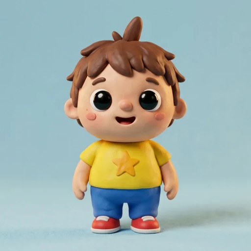
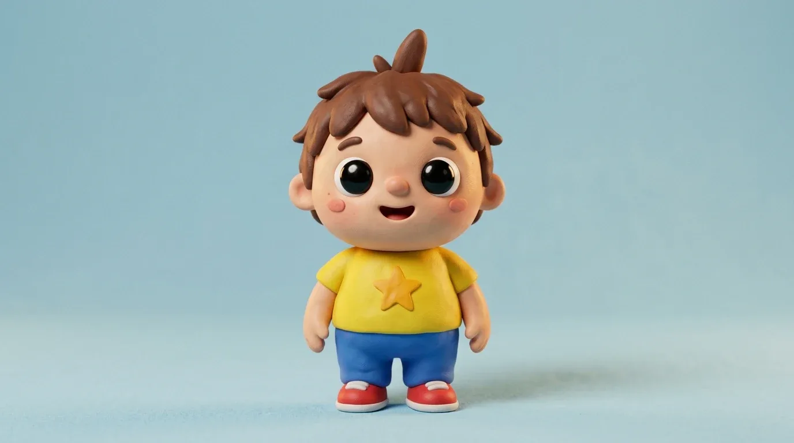
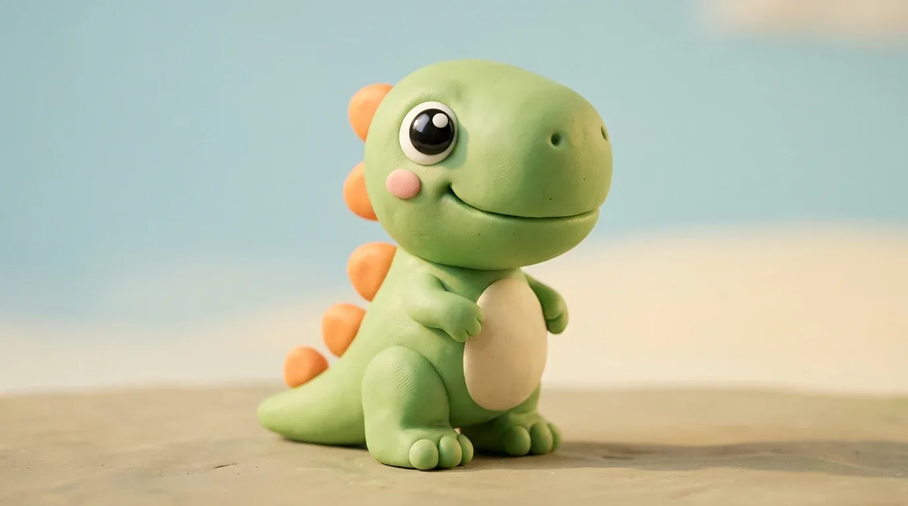
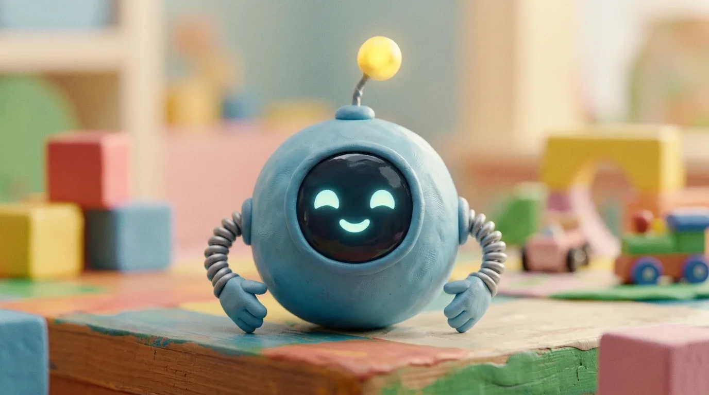

<p align="center"></p>

# Los juegos de Maxi

Un juego web para un niño de **3 años**, hecho por su papá con ayuda de IA. Se juega en el celular o la tablet en horizontal. Todo tiene estilo de plastilina (claymation): los personajes, los escenarios, los objetos y los videos.

Los personajes son **Maxi** (el protagonista), **Rex** (un bebé dinosaurio), **Bip** (un robot ayudante) y **Gruñi** (una nube traviesa que esconde cosas, pero nunca da miedo).

| Maxi | Rex | Bip | Gruñi |
|---|---|---|---|
|  |  |  |  |

## Reglas de diseño

El juego está pensado para alguien que todavía no lee:

- **No se puede perder.** No hay tiempo límite, vidas ni puntajes.
- **No hay que leer nada.** Todo se explica con voz, en español de Chile.
- **No hay nada que asuste.** Hasta la nube "villana" es tierna.
- **Botones grandes**, de al menos el 10 % del ancho de la pantalla, que responden al instante con sonido y animación.
- **Comida sin culpa.** Nunca se dice "mala" ni "prohibida". Si Gruñi come muchos dulces, le duele un poquito la guatita y se le pasa con agua o una fruta.
- **La pista se gana buscando.** En la primera versión la pista aparecía sola a los pocos segundos y el niño aprendió a esperarla en vez de buscar. Ahora en la mayoría de los juegos solo aparece después de intentar.

## Los 4 minijuegos

1. **¿Dónde está el juguete?** Gruñi escondió los juguetes en 5 mundos: casa, parque, valle, playa y taller. Cada mundo tiene 3 niveles, y en el último Gruñi vuelve y cambia un juguete de lugar.
2. **Los colores de Bip.** Hay que buscar algo de un color o contar del 1 al 5 para encender la antena de Bip. Tiene 5 niveles.
3. **¡Que no llueva!** Tiene 3 mundos: alegrar a Gruñi con regalos, prepararle la merienda y acompañarlo durante el día. El clima cambia con su ánimo: lluvia, sol, arcoíris y estrellas.
4. **La memoria de Rex.** Pares de cartas de dinosaurios en 5 niveles. En el celular hay menos cartas que en la tablet para que se vean grandes.

Cada minijuego, y cada mundo de "¡Que no llueva!", termina con su propio video de premio.

## Cómo jugarlo

No necesita instalar nada ni compilar: son archivos HTML, CSS y JavaScript.

1. Instala [Node.js](https://nodejs.org).
2. En la carpeta que contiene este repositorio, corre:
   ```bash
   npx -y serve@14 -l tcp://0.0.0.0:8080 juego-juguetes
   ```
   En Windows también puedes hacer doble clic en `tools/iniciar_servidor.bat`, que además muestra la dirección para el celular.
3. En el PC abre `http://localhost:8080`. En el celular o la tablet, conectados al mismo wifi, abre `http://<IP del PC>:8080`.
4. En el iPhone, en Safari: Compartir → "Agregar a inicio". Así se abre a pantalla completa, como una app.

**Para jugar sin internet** (en el auto o en modo avión), el juego tiene que estar publicado con `https`, por ejemplo en GitHub Pages o Netlify. Safari solo permite la caché sin internet (service worker) en páginas `https` o en `localhost`. Desde una IP de la red, el juego depende de que el PC esté encendido.

**Rincón de los papás:** mantén presionada la esquina inferior izquierda 3 segundos. Desde ahí se puede ajustar el volumen, apagar la música, abrir todos los mundos y niveles, reiniciar el progreso y ver un diagnóstico de pantalla.

## Cómo se hizo, paso a paso

### 1. La idea y las reglas
Primero se escribieron las reglas del juego y de los personajes en [`CLAUDE.md`](CLAUDE.md). Ese archivo es el documento de instrucciones que lee Claude Code: qué personajes hay, qué reglas no se rompen, cómo está organizado el código y cómo se trabaja (un commit por tarea, explicar antes de hacer cada cosa, nunca borrar los archivos originales). Se actualizó con cada minijuego nuevo.

### 2. Personajes, escenarios y videos con Google Flow
Todo el arte se generó en **Google Flow**. Para hacerlo, Claude manejó Flow en el navegador usando la extensión **Claude in Chrome**:

- **Hojas de personaje** (vistas de frente, de lado y de espalda) de Maxi, Rex, Bip y Gruñi, para que se vieran iguales en todas las imágenes.
- **Escenarios** de plastilina para cada mundo: casa, parque, valle de dinosaurios, playa y taller.
- **Hojas de sprites** con los juguetes, los objetos de colores, la comida, los regalos, las cartas de memoria y los distintos estados de ánimo de cada personaje (por ejemplo, Gruñi triste, sorprendido, riendo o feliz).
- **11 videos cortos** de celebración animados en plastilina, uno distinto por minijuego y por mundo.

### 3. Recorte y compresión
Las hojas de Flow traen varios objetos sobre fondo blanco. Los scripts de [`tools/`](tools) (Python con Pillow y NumPy) los separan y les quitan el fondo:

- [`tools/recorte.py`](tools/recorte.py) tiene las funciones comunes:
  - Busca las filas y columnas vacías para separar cada objeto.
  - Quita el fondo pintando desde las esquinas (flood fill), para no borrar los blancos que están dentro del objeto.
  - Rellena el óvalo de los objetos que son blancos como el fondo, como un huevo o una pelota.
- `recortar_colores.py`, `recortar_lluvia.py` y `recortar_memoria.py` recortan las hojas de cada minijuego y guardan cada objeto en WebP liviano.
- Los videos se pasaron por **ffmpeg** a 720p (cerca de 1 MB cada uno) para que carguen rápido en el celular. Los originales se conservan.

### 4. Las voces, con un servidor de voz local
Las 309 frases del juego se generaron en un servidor de voz propio, dentro de la red de la casa. No se usó ningún servicio en la nube. El detalle completo está en [Cómo se crearon las voces](#cómo-se-crearon-las-voces).

### 5. Programación y animación con Claude Code
El juego lo programó **Claude Code** a partir de las reglas de `CLAUDE.md`, tarea por tarea:

- **Sin frameworks ni build:** JavaScript puro, en scripts que se cargan en orden desde `index.html`.
- **Módulos compartidos** en `js/comun/`: voz, audio, pistas, progreso, videos, confeti y rincón de los papás. Cada minijuego vive en `js/minijuegos/` y se agrega solo al menú con `registrarMinijuego(...)`.
- **Animación:** todo es CSS, con saltos, giros 3D de las cartas, brillos, lluvia, arcoíris y estrellas. Los objetos se pueden tocar o arrastrar.
- **Sonido:** la música de fondo y los efectos se generan en el navegador con Web Audio. No usan archivos de audio, salvo las voces.
- **Pantalla:** las medidas dentro del escenario usan unidades `cqw` para que se vea igual en cualquier tamaño. Si el iPhone queda en vertical, el escenario se gira por dentro para seguir en horizontal.
- **App instalable (PWA):** `manifest.json`, íconos y un service worker (`sw.js`) que guarda los archivos para jugar sin internet. La lista de archivos la genera `tools/actualizar_sw.py`.

### 6. Pruebas
Claude jugó cada nivel con scripts en el navegador, incluidos los errores, las pistas y los videos del final, y sacó capturas en tamaño de celular y tablet. Las pruebas finales se hacen en el iPhone y la tablet reales, porque Safari en iOS tiene sus propias reglas de audio, video y pantalla.

## Cómo se crearon las voces

### El servidor
- Es un "estudio de voz" casero que corre en un PC de la casa con una **NVIDIA RTX 3060 (12 GB)**, dentro de Docker, con una página web y una API.
- Solo es accesible dentro de la red local (`http://192.168.1.100:8020`).
- El código del servidor no está en este repositorio; aquí solo están los scripts que le piden las frases.

| Para qué | Modelo | Licencia del modelo |
|---|---|---|
| Diseñar las voces a partir de una descripción | [Qwen3-TTS 1.7B VoiceDesign](https://huggingface.co/Qwen/Qwen3-TTS-12Hz-1.7B-VoiceDesign) | Apache 2.0 |
| Hablar con la voz elegida (clonación instantánea) | [Qwen3-TTS 1.7B Base](https://huggingface.co/Qwen/Qwen3-TTS-12Hz-1.7B-Base), con el motor [faster-qwen3-tts](https://github.com/andimarafioti/faster-qwen3-tts) | Apache 2.0 |
| Revisar que cada toma diga el texto correcto | [Whisper turbo](https://github.com/openai/whisper) (OpenAI) | MIT |
| Medir cuánto se parece cada toma a la voz elegida | [ECAPA-TDNN](https://huggingface.co/speechbrain/spkrec-ecapa-voxceleb) (SpeechBrain) | Apache 2.0 |

### ¿Se entrenó algún modelo?
**No.** No se hizo ningún entrenamiento ni ajuste fino (fine-tuning), y **las voces no son de personas reales**. El proceso fue este:

1. **Diseño de la voz con texto.** Al modelo VoiceDesign se le describió en inglés la voz que se quería. Para la narradora (`juego-mujer`):
   > Warm, cheerful young adult female voice, like a kind preschool teacher talking to toddlers. Neutral Latin American Spanish. Slow, very clear pronunciation, sweet and playful, smiling tone, encouraging and gentle.

   Para Bip y Gruñi (`juego-hombre`):
   > Warm, friendly adult male voice, like a fun and gentle dad or children's TV host talking to toddlers. Neutral Latin American Spanish. Slow, very clear pronunciation, playful, smiling tone, encouraging and soft, medium pitch.
2. **Elegir entre candidatas.** Con la misma frase de prueba ("¡Hola! ¿Quieres jugar conmigo? Vamos a buscar el color rojo…") se generaron 3 candidatas por voz, cada una con una semilla distinta. Se escucharon y se eligió la que mejor sonaba para niños.
3. **Guardar la voz.** La toma elegida se guardó en el servidor como "voz de referencia". Desde ahí, el modelo Base habla con esa voz con solo escuchar esa muestra (clonación instantánea, sin entrenamiento).
4. **Generar todas las frases por lotes.** [`tools/generar_voces.py`](tools/generar_voces.py) envía el guion de 15 en 15 frases. El servidor hace 4 tomas por frase, transcribe cada una con Whisper para confirmar que dijo el texto, mide con ECAPA cuál se parece más a la voz de referencia y se queda con la mejor. Si ninguna toma pasa, hace una ronda extra.
5. **Revisar.** Cada carpeta de voces tiene un `manifest.json` con lo que entendió Whisper (`heard`) y si la frase pasó la revisión. Las frases dudosas se reescriben y se generan solas con [`tools/agregar_voces.py`](tools/agregar_voces.py), que solo agrega las nuevas al juego.

### Las voces en el juego
- **Guiones:** [`tools/frases.json`](tools/frases.json) (narradora, 102 frases) y [`tools/frases_hombre.json`](tools/frases_hombre.json) (Bip y Gruñi, 207 frases). Los audios están en `assets/voz/<id>.mp3`.
- **Gruñi** usa la misma voz que Bip, pero el juego la reproduce un 12 % más rápido (`playbackRate` de Web Audio) para que suene más travieso y se distinga.
- **Variantes:** varias frases tienen 2 o 3 versiones y el juego elige una al azar para no repetir siempre lo mismo.
- **Respaldo:** si falta un audio, el juego usa la voz del sistema con el mismo texto.

### Consejos que funcionaron para escribir las frases
- Usar mucha puntuación expresiva (`¡!`, `¿?`, comas). La entonación depende mucho de eso.
- Escribir los números con letras ("tres manzanas").
- Evitar los puntos suspensivos, porque producen pausas raras.
- Evitar palabras sueltas muy cortas ("¡Sí!"); sale mejor "¡Sí, muy bien!".

## Estructura del proyecto

```
index.html            pantallas del juego y carga de los scripts
css/estilos.css       estilos y animaciones
js/comun/             módulos compartidos: voz, audio, progreso, pistas, menú, rincón de los papás
js/minijuegos/        un archivo por minijuego
js/main.js            arranque del juego
sw.js                 service worker (caché para jugar sin internet)
assets/               imágenes, videos, voces e íconos
tools/                scripts para el PC: recortes, voces, íconos y lista de la caché
CLAUDE.md             instrucciones del proyecto para Claude Code
```

Para agregar un minijuego, mira la sección "Estructura" de [`CLAUDE.md`](CLAUDE.md). Después de cambiar cualquier archivo, corre `python tools/actualizar_sw.py` para que los dispositivos descarguen la versión nueva.

## Licencia

**Puedes usar, copiar, modificar y compartir este proyecto gratis, siempre que no sea con fines comerciales.** No se puede vender, cobrar por él ni usarlo para generar ingresos de ninguna forma (por ejemplo, con publicidad o suscripciones).

Hay dos licencias, porque el código y el material creativo necesitan textos legales distintos:

| Qué | Licencia | Texto completo |
|---|---|---|
| **Código:** HTML, CSS, JavaScript, service worker y scripts de `tools/` | [PolyForm Noncommercial 1.0.0](https://polyformproject.org/licenses/noncommercial/1.0.0) | [`LICENSE-CODIGO.md`](LICENSE-CODIGO.md) |
| **Material creativo:** todo `assets/` (personajes, escenarios, objetos, videos, voces e íconos), los guiones de las voces, los personajes y la documentación | [CC BY-NC-SA 4.0](https://creativecommons.org/licenses/by-nc-sa/4.0/deed.es) | [`LICENSE-ASSETS.txt`](LICENSE-ASSETS.txt) |

El resumen de qué cubre cada una está en [`LICENSE`](LICENSE).

**Lo que sí puedes hacer:**
- Jugarlo, en tu casa, en un jardín infantil o en una escuela.
- Estudiar el código y aprender de él.
- Modificarlo y hacer tu propia versión, por ejemplo con otros personajes o en otro idioma.
- Compartirlo con otras personas.

**Lo que tienes que hacer al usarlo:**
- **Dar crédito**, por ejemplo: *"Los juegos de Maxi", por Nolobox (https://github.com/Nolobox/juego-de-maxi), CC BY-NC-SA 4.0*.
- **Compartir con la misma licencia** las imágenes, videos o voces que modifiques (CC BY-NC-SA).
- **Mantener el aviso de copyright** si compartes el código (PolyForm).

**Lo que no puedes hacer:**
- Venderlo o cobrar por jugarlo.
- Publicarlo en una tienda de apps de pago o con compras dentro de la app.
- Ponerle publicidad o usarlo para promocionar un producto o servicio.
- Usar a los personajes (Maxi, Rex, Bip y Gruñi) en productos que se vendan.

Para un uso comercial, pide permiso al autor en [github.com/Nolobox](https://github.com/Nolobox).

**Notas:**
- Las imágenes y los videos se generaron con Google Flow y las voces con los modelos indicados arriba, bajo los términos de cada servicio. En algunos países el material generado con IA tiene una protección de derechos de autor limitada. La licencia se aplica en la medida en que la ley lo permite.
- Esto no es asesoría legal.

## Créditos

Hecho por **Nolobox** para su hijo Maxi, con:
- [Claude Code](https://claude.com/claude-code) para la programación, los scripts de recorte y la documentación.
- [Claude in Chrome](https://claude.com/chrome) para manejar Google Flow.
- [Google Flow](https://labs.google/flow), con los modelos de imagen y video de Google, para los personajes, los escenarios, los objetos y los videos.
- Qwen3-TTS, Whisper y ECAPA (SpeechBrain) en un servidor local para las voces.
